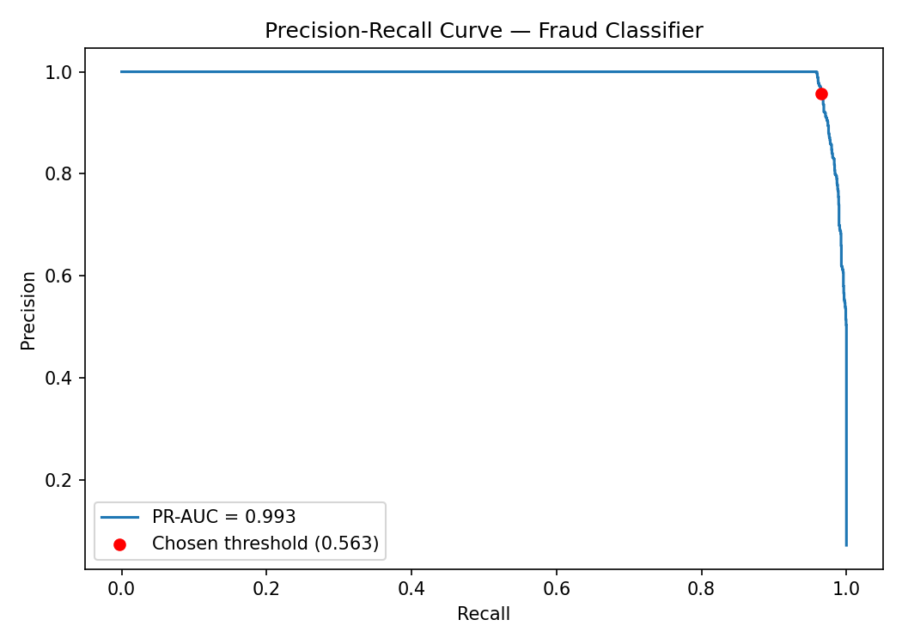
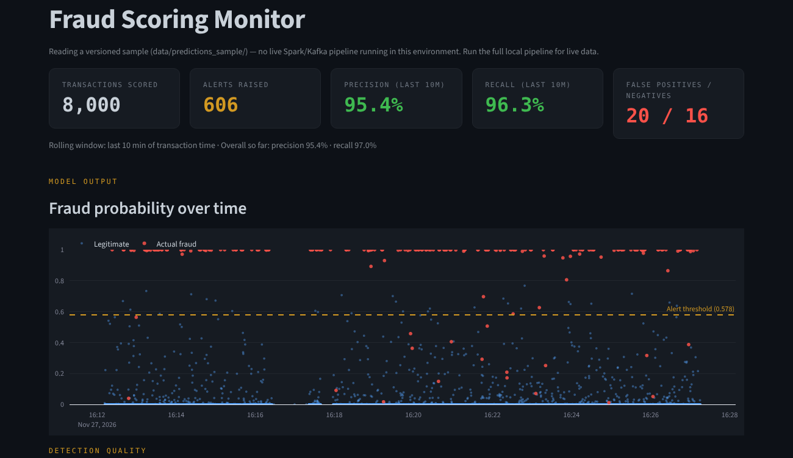
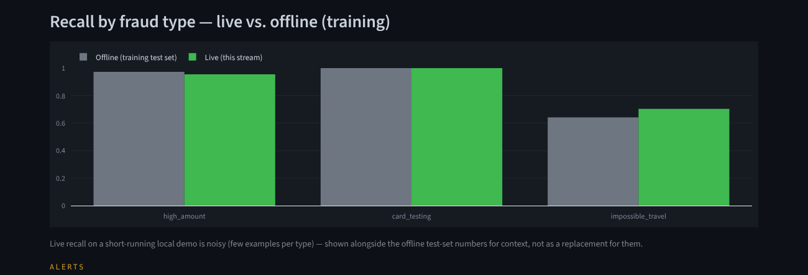
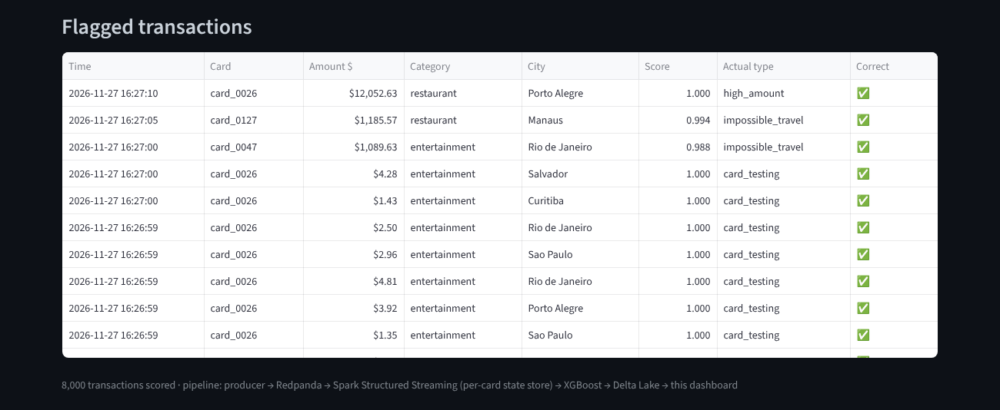

# Real-Time Fraud Detection: ML Scoring Layer

[](https://github.com/DiegoTDDD/realtime-fraud-detection-ml/actions/workflows/tests.yml)
[](https://github.com/DiegoTDDD/realtime-fraud-detection-ml/actions/workflows/pipeline-check.yml)
[](LICENSE)

**Problem.** A streaming fraud monitor that only counts transactions tells a fraud team what already happened. To act while a card is being abused, each transaction needs a fraud score the moment it arrives, and that score is only useful if the team can trust how many alerts it will raise and which kinds of fraud it misses.

**Solution.** An XGBoost classifier, trained offline, scores every transaction of a live Kafka stream inside Spark Structured Streaming. A dashboard shows its live precision and recall for each fraud pattern.

- **Live dashboard:** [realtime-fraud-detection-ml.streamlit.app](https://realtime-fraud-detection-ml.streamlit.app)
- **Model card:** [`docs/model_card.md`](docs/model_card.md) (data, metrics per pattern, limitations, risks)
- **Design decisions:** [`docs/adr/`](docs/adr/README.md)
- **Builds on:** [realtime-fraud-streaming](https://github.com/DiegoTDDD/realtime-fraud-streaming) (producer and Redpanda broker)
- **Case study:** [`docs/case_study.pdf`](docs/case_study.pdf)

---

## Results

Held-out test set: the latest 20% of 150,000 transactions, split by time. Reproducible with `python training/generate_training_data.py && python training/train_model.py`.

| Metric (threshold 0.5625) | Value |
|---|---|
| PR-AUC | 0.9925 |
| Precision | 95.75% |
| Recall | 96.55% |

| Fraud pattern | Test examples | Recall |
|---|---|---|
| card_testing (bursts of tiny charges) | 1,772 | 100% |
| high_amount (R$5k to R$15k) | 185 | 96.2% |
| impossible_travel (charge far from home) | 190 | **64.7%**, the known weak spot (see [Limitations](#limitations)) |

The threshold is not 0.5 or the best-F1 point. It maximizes the mean recall across the three patterns while keeping precision at 95% or more, at most one false alarm per 20 alerts ([ADR 0004](docs/adr/0004-threshold-policy.md)). The best-F1 point would be driven by card testing, which is 83% of fraud rows.



---

## Architecture

```
┌────────────┐     ┌────────────┐     ┌──────────────────────┐     ┌──────────────┐     ┌─────────────┐
│  Producer  │     │  Redpanda  │     │  Spark Structured     │     │   Parquet    │     │  Streamlit  │
│ (Project 1)│ ──▶ │ (Kafka API)│ ──▶ │  Streaming            │ ──▶ │  Predictions │ ──▶ │  Dashboard  │
│            │     │            │     │                       │     │              │     │             │
│ card txns  │     │  topic:    │     │ foreachBatch:         │     │  tx + score +│     │ live P/R +  │
│ + labels   │     │transactions│     │ feature eng. + XGBoost│     │  prediction  │     │ alert feed  │
└────────────┘     └────────────┘     └──────────────────────┘     └──────────────┘     └─────────────┘
                                                  ▲
                                                  │ loads once, not per batch
                                          ┌───────┴────────┐
                                          │ training/       │
                                          │ model.joblib     │
                                          │ (offline-trained)│
                                          └──────────────────┘
```

This job is an **independent second consumer** of Project 1's `transactions` topic — it doesn't modify or depend on Project 1's own Bronze/Gold pipeline running at the same time, only on the topic existing.

**Training** (`training/`): `generate_training_data.py` writes 150,000 transactions with the producer's own simulation logic ([ADR 0001](docs/adr/0001-synthetic-training-data.md)). `train_model.py` splits them by time, builds features, trains XGBoost with class weights ([ADR 0005](docs/adr/0005-class-weights-and-pr-auc.md)) and chooses the threshold.

**Features** (`training/features.py`) are shared by training and the scoring job, and a unit test checks that both produce identical values ([ADR 0006](docs/adr/0006-shared-features-and-time-split.md)):

| Feature | Catches |
|---|---|
| `amount` | high_amount |
| `distance_km_from_home` | impossible_travel (three designs compared in [ADR 0002](docs/adr/0002-distance-feature.md)) |
| `tx_count_last_5min`, `time_since_last_tx` | card_testing bursts |
| `hour_of_day`, `category` | general behaviour |

**Serving** (`scoring/score_stream.py`): a second, independent consumer of the `transactions` topic. It loads the model once and scores each micro-batch in `foreachBatch`. Per-card velocity state is kept across micro-batches in the process ([ADR 0003](docs/adr/0003-process-local-velocity-state.md)). Results go to Parquet, which the dashboard reads.

---

## Dashboard

### Live precision/recall + probability distribution


### Recall by fraud type — live vs. offline


### Flagged transactions feed


---

## Running it locally

This pipeline spans two repos and the pieces must be started in the order below. The scoring job's Kafka source resolves partition offsets on startup, which fails outright (`UnknownTopicOrPartitionException`) if the `transactions` topic doesn't exist yet — and the topic isn't created until the producer publishes its first message. Starting the producer before the scoring job isn't a style preference; the reverse order was tested and fails.

### Prerequisites

- Docker Desktop installed and running
- Java 17 installed (`java -version` should report 17)
- **Windows only:** `C:\hadoop\bin\winutils.exe` and `C:\hadoop\bin\hadoop.dll` present. Get them from the community `cdarlint/winutils` repo — use the **raw.githubusercontent.com** URL, not a `github.com/.../raw/...` link (the latter can silently return an HTML page instead of the binary). A patch-version mismatch with the Hadoop version Spark resolves at runtime (e.g. binaries from `hadoop-3.3.5` against a Spark build pulling `hadoop-client-runtime:3.3.4`) is fine. `winutils.exe` needs the Microsoft Visual C++ 2010 runtime: if running `C:\hadoop\bin\winutils.exe ls C:\hadoop` fails, install the "Microsoft Visual C++ 2010 Redistributable (x64)" (for example `choco install vcredist2010`); without it Spark cannot create its checkpoint folders.
- A local clone of [`realtime-fraud-streaming`](https://github.com/DiegoTDDD/realtime-fraud-streaming) (Project 1) as a sibling directory — this repo reuses its Redpanda broker and producer, not a copy of them.

### Steps

**1. Set up this repo's environment**
```bash
conda create -n fraud-ml python=3.11 -y
conda activate fraud-ml
pip install -r requirements.txt
```

**2. Set up Project 1's environment** (separate env, its own `requirements.txt` — it needs `confluent-kafka` and `faker`, which this repo's model/serving code doesn't)
```bash
cd ../realtime-fraud-streaming
conda create -n fraud python=3.11 -y
conda activate fraud
pip install -r requirements.txt
```

**3. Start Redpanda** (still in the Project 1 repo)
```bash
docker compose up -d redpanda
```

**4. Train the model** — **this repo** (not the Project 1 repo), `fraud-ml` env. One-time, or whenever retraining; doesn't need Redpanda running:
```bash
cd ../realtime-fraud-detection-ml
conda activate fraud-ml
python training/generate_training_data.py
python training/train_model.py
```

**5. Start the producer** — **terminal 1**, Project 1 repo, `fraud` env. This is the step that creates the `transactions` topic if it doesn't already exist (e.g. after a container restart with no persistent volume):
```bash
cd ../realtime-fraud-streaming
conda activate fraud
python producer/producer.py
```
Leave it running. Wait for the first `sent=... frauds=...` line before moving on — that confirms the topic exists.

**6. Start the scoring job** — **terminal 2**, this repo, `fraud-ml` env:
```bash
conda activate fraud-ml
python scoring/score_stream.py
```
`startingOffsets: earliest` means it reprocesses the full topic history on first run, so expect one large initial batch before it settles into small continuous ones.

**7. Launch the dashboard** — **terminal 3**, this repo, `fraud-ml` env:
```bash
conda activate fraud-ml
streamlit run dashboard/app.py
```

Open `http://localhost:8501`.

### Checking the topic exists

`docker exec redpanda rpk topic list` shows what topics currently exist on the broker. If `transactions` isn't there — common after a host reboot, since Project 1's Redpanda container doesn't use a persistent volume by default — step 6 will fail. Go back to step 5 and confirm the producer has logged at least one `sent=... frauds=...` line before retrying.

---

## Deploying the dashboard

Streamlit Community Cloud runs plain Python only — no Docker, no Spark, no local Redpanda broker — so the deployed dashboard can't run the live scoring pipeline itself. It reads a small, versioned sample instead, the same pattern Project 1 uses for its own deployed dashboard.

**One-time, before deploying:**

1. Run the full local pipeline for a while (producer + scoring job) so `data/predictions/` has a reasonable amount of data.
2. Export a sample:
   ```bash
   python scoring/export_sample.py
   ```
   This writes `data/predictions_sample/predictions_sample.parquet` — capped at 8,000 rows, keeping every flagged transaction plus a random sample of the rest, so the alerts feed and precision/recall charts stay meaningful. Unlike `data/predictions/`, this sample file is **not** gitignored — it's meant to be committed.
3. Commit and push it:
   ```bash
   git add data/predictions_sample/predictions_sample.parquet
   git commit -m "Add dashboard sample for deployment"
   git push
   ```

**Deploying:**

1. On [share.streamlit.io](https://share.streamlit.io), create a new app from this repo, branch `master`, main file path `dashboard/app.py`.
2. Set the app's dependency file to `dashboard/requirements.txt` (not the root `requirements.txt` — that one includes `pyspark` and `xgboost`, which the dashboard itself never imports and which would slow the build for no reason).
3. Deploy. `dashboard/app.py` detects that `data/predictions/` is empty in the cloud environment and automatically falls back to the committed sample — no code changes needed between local and deployed runs.

The deployed dashboard will show a caption noting it's reading the versioned sample rather than a live pipeline, exactly as Project 1's does.

---

## Design decisions

| Decision | Why |
|---|---|
| [Synthetic training data from the producer's logic](docs/adr/0001-synthetic-training-data.md) | The live stream had only 189 fraud examples. This data is reproducible and matches the stream's distribution |
| [`distance_km_from_home` for impossible travel](docs/adr/0002-distance-feature.md) | The best of three measured designs (0.65 recall versus 0.59 to 0.65 and 0.62) |
| [Process-local velocity state](docs/adr/0003-process-local-velocity-state.md) | Simple and correct for one process. Redis or Spark state is the step to take before running several workers |
| [Mean recall across patterns under a 95% precision floor](docs/adr/0004-threshold-policy.md) | Best F1 lets the most frequent pattern hide a rare one |
| [Class weights, PR-AUC](docs/adr/0005-class-weights-and-pr-auc.md) | Resampling would break the time-based velocity features. Accuracy is meaningless at 7.5% fraud |
| [Shared feature module, time split, home cities from training rows](docs/adr/0006-shared-features-and-time-split.md) | Removes the training/serving skew and the test-set leak found in review |

What the project shows:

- **Applied ML on imbalanced data** — class weights (not resampling) for a ~2-7% fraud rate, PR-AUC as the primary metric, a documented threshold-selection strategy (macro-recall across fraud types under a precision floor, not a default 0.5 or aggregate F1)
- **Feature engineering with a falsifiable process** — three iterations tested and measured against the held-out test set for the hardest fraud pattern, with the two rejected approaches documented alongside the reasoning for why they didn't work
- **Streaming ML serving** — a trained model integrated into Spark Structured Streaming via `foreachBatch`, with feature parity enforced between training and serving to avoid training-serving skew
- **Stateful streaming under a documented constraint** — velocity features computed across micro-batches using process-local state, with the single-process limitation stated explicitly rather than glossed over
- **Real-world Windows/Spark debugging** — resolved five distinct infrastructure failures end-to-end (missing Hadoop native binaries, a non-persistent Kafka topic, Python worker spawn failures, schema-inference errors on null columns), each with a root-cause explanation, not just a fix
- **ML-aware dashboarding** — live precision/recall (not just volume), because Project 1's injected ground-truth labels make this rare "self-grading" view possible

---

## Limitations

- **impossible_travel recall is 64.7%.** About 13.5% of legitimate transactions also happen away from the card's home city, and the test set has only 190 examples of this pattern (about ±7 points of uncertainty). Closing the gap needs signal the stream does not carry, such as travel history or device location.
- **Synthetic data.** The fraud patterns are simple and fixed, so card-testing recall of 100% will not carry over to real transactions.
- **Single scoring process.** Velocity state lives in memory: it is lost on restart and is not shared across workers.
- **Threshold chosen on the test set.** The reported precision is slightly optimistic. A separate validation split is the fix if the policy grows.
- **No drift alerts or scheduled retraining.** Live precision and recall are visible on the dashboard, but nothing acts on them.

More in the [model card](docs/model_card.md#limitations).

---

## Project layout

```
realtime-fraud-detection-ml/
├── training/
│   ├── generate_training_data.py   # reproducible batch data (reuses the producer's fraud logic)
│   ├── features.py                 # feature engineering shared by training and serving
│   ├── evaluation.py               # time split, threshold policy, recall per pattern
│   ├── train_model.py              # trains XGBoost and writes the artifacts below
│   ├── model.joblib                # model + feature list + threshold (gitignored)
│   ├── card_home_city.json         # home-city map, used unchanged at serving time
│   └── metrics.json                # offline evaluation results
├── scoring/
│   ├── score_stream.py             # Spark Structured Streaming + foreachBatch scoring job
│   └── export_sample.py            # small versioned sample for the deployed dashboard
├── dashboard/
│   ├── app.py                      # Streamlit model-quality dashboard
│   └── requirements.txt            # light dependencies for the deployed dashboard
├── tests/                          # pytest: features, train/serve parity, threshold policy, training
├── scripts/exploration/            # one-off script used to inspect the first Bronze data
├── data/
│   ├── training_raw.parquet        # generated training set (gitignored)
│   ├── predictions/                # live scored transactions (gitignored)
│   ├── predictions_sample/         # small sample for the deployed dashboard (committed)
│   └── _checkpoints/               # Spark streaming checkpoints (gitignored)
├── docs/
│   ├── model_card.md
│   ├── adr/                        # architecture decision records
│   ├── screenshots/
│   └── case_study.pdf
├── .github/                        # CI: tests, pipeline, Windows, dashboard, security, app health
├── pyproject.toml                  # project metadata, pytest and ruff settings
├── requirements.txt                # full pipeline
└── requirements-test.txt           # light set for the unit tests
```

---

## Notes on the data

Training data is synthetic, generated with the producer's exact simulation logic in batch rather than by running the real-time producer for hours. Live scoring runs against the real Kafka stream. The producer's ground-truth fraud labels make live precision and recall possible on the dashboard; most real fraud dashboards cannot show this, because they have no oracle to check predictions against in real time.

## Automated checks

- **Tests** (`tests.yml`) run on every push and pull request: `ruff` (including type hints on every training and scoring function, and no `print` outside scripts) and 23 unit tests. They cover the features, the check that the scoring job's micro-batch features equal the training features, the threshold policy (including a case where best F1 would drop a rare pattern), the time split, home cities learned from training rows only, the data generator's fraud patterns and a small end-to-end training run.
- **Pipeline check** (`pipeline-check.yml`) generates the training data, trains the model, starts Redpanda and the producer from `realtime-fraud-streaming`, runs the Spark scoring job, checks that real predictions are written (probabilities between 0 and 1) and opens the dashboard.
- **Windows check** (`windows-check.yml`) runs the README steps on Windows with conda, including the Hadoop binaries Spark needs there.
- **Security audit** (`security-audit.yml`) audits every `requirements*.txt` with `pip-audit` whenever dependencies change and every Monday. It fails only when a vulnerable package has a fixed version available.
- **App health** (`app-health.yml`) opens the [live app](https://realtime-fraud-detection-ml.streamlit.app) in a real browser after each push and once a day (waking it if it was asleep) and fails if the app shows an error.
